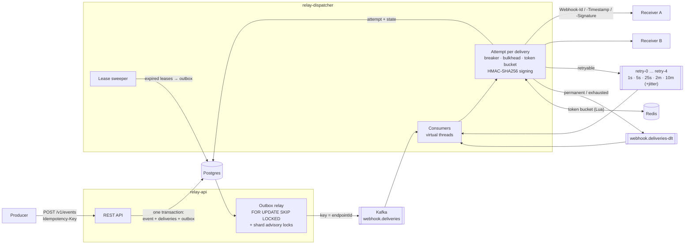

# webhook-relay

[](https://github.com/gouranshul/webhook-relay/actions/workflows/ci.yml)


[](LICENSE)

**A reliable webhook delivery service.** It never loses events, signs every payload, retries with backoff and
jitter, isolates slow or failing receivers, and shows its throughput with load tests rather than claims.

## Why webhooks are hard

- **Dual writes lose events.** "Save to the DB, then publish" drops events when the process dies in between.
- **Receivers fail in every way possible**: 500s, timeouts, 429s with `Retry-After`, TLS errors, silent hangs.
- **One slow receiver can stall everyone** sharing its queue partition (the noisy neighbour).
- **Retries cause storms and duplicates**: synchronized retries knock a recovering receiver over again, and
  exactly-once over HTTP does not exist.
- **Receivers must trust the payload**: it needs a signature, and replay protection against captured requests.

## Architecture



1. The API writes the event, one delivery row per subscribed endpoint, one outbox row each, and the
   idempotency key **in one transaction** ([ADR 0001](docs/adr/0001-transactional-outbox-polling.md)).
2. The outbox relay publishes rows to Kafka keyed by endpoint, safe on any number of instances.
3. The dispatcher claims each delivery with a lease (the idempotency check), then starts the HTTP attempt on a
   virtual thread and moves on. Slow or failing endpoints only use their own bulkhead permits
   ([ADR 0004](docs/adr/0004-per-endpoint-isolation.md)).
4. Failures go to non-blocking retry topics with per-message jitter and `Retry-After`, then to the DLT
   ([ADR 0003](docs/adr/0003-non-blocking-retry-topics.md)). An endpoint whose deliveries keep landing in
   the DLT is auto-paused, and resuming it replays what was parked.

## Delivery guarantees

| | |
|---|---|
| **No lost events** | Accepted (202) means stored with its outbox rows. Every delivery ends `SUCCEEDED`, `FAILED` (on the DLT, replayable) or `CANCELLED` (endpoint deleted). Proven under Kafka restarts, Postgres latency, receiver outages and a 45 s Kafka outage: [chaos results](#chaos-tests). |
| **At-least-once** | Duplicates are possible (lost responses, crashes after a send). Redelivered Kafka records never cause a second send; the delivery row is claimed atomically. Receivers **must dedupe on `Webhook-Id`** ([ADR 0002](docs/adr/0002-at-least-once-and-receiver-dedupe.md)). |
| **Ordering** | First attempts per endpoint *start* in order. Retries and concurrent attempts can complete out of order. Use `created_at`/versions in your data. |
| **Idempotent ingest** | Same `Idempotency-Key` within 24 h returns the original response; a different body with a reused key is a 422. |
| **Signed** | `Webhook-Signature: v1=hex(HMAC-SHA256(secret, timestamp + "." + body))`, timestamps older than 5 min rejected. |

## Verifying signatures (receiver side)

```java
// relay-common ships the verifier; any language can do the same in ~10 lines.
WebhookVerifier verifier = new WebhookVerifier();   // 5-minute tolerance, constant-time compare
WebhookVerifier.Result result = verifier.verify(
        secret,                                      // "whsec_..." shown once when the endpoint was created
        request.getHeader("Webhook-Timestamp"),
        request.getHeader("Webhook-Signature"),     // may hold several "v1=..." during secret rotation
        rawBody);                                    // the exact bytes received, before any JSON parsing
if (!result.isValid()) {
    return ResponseEntity.status(401).build();
}
if (alreadyProcessed(request.getHeader("Webhook-Id"))) {   // at-least-once: dedupe
    return ResponseEntity.ok().build();
}
```

## Quickstart

```bash
cp .env.example .env            # fill in the placeholders, e.g. RELAY_SECRET_KEY=$(openssl rand -base64 32)
docker compose up -d --build    # Kafka (KRaft), Postgres 18, Redis, api, dispatcher, mock receiver, Prometheus, Grafana, Jaeger
set -a; . ./.env; set +a
```

```bash
# 1. Register an endpoint. The signing secret is shown once.
curl -s localhost:8080/v1/endpoints -H "Authorization: Bearer $RELAY_API_TOKEN" -H 'Content-Type: application/json' \
  -d '{"url":"http://mock-receiver:8090/hooks/demo","eventTypes":["order.created"]}'

# 2. Publish an event (idempotent).
curl -s localhost:8080/v1/events -H "Authorization: Bearer $RELAY_API_TOKEN" -H 'Content-Type: application/json' \
  -H 'Idempotency-Key: order-1001' -d '{"type":"order.created","data":{"order_id":"ord_1001","amount_cents":4200}}'

# 3. See where it went: status, every attempt, latency, response code.
curl -s "localhost:8080/v1/deliveries?status=SUCCEEDED" -H "Authorization: Bearer $RELAY_API_TOKEN"
```

Grafana: <http://localhost:3000> (dashboard "webhook-relay") · Jaeger: <http://localhost:16686> · Prometheus: <http://localhost:9090>

Operations: `GET /v1/deliveries/{id}` (attempts), `POST /v1/deliveries/{id}/replay`,
`POST /v1/deliveries/replay` (bulk from the DLT by endpoint and time range), `PATCH /v1/endpoints/{id}` (pause/resume).

## Benchmarks

Measured with k6 against the full docker compose stack on **one laptop** (Intel i5-1235U, 12 threads, 16 GB,
Docker Desktop with 12 vCPU / 7.6 GiB; Kafka, Postgres, Redis, both services, the receiver and k6 all share it).
Each event fans out to 4 endpoints; the receiver fails 10 % of requests with 503.

| Scenario | Deliveries/s | Accept → delivered, first attempt | Lost / duplicates |
|---|---|---|---|
| 60 events/s, fast receivers (50–200 ms) | **239** | p50 205 ms, p95 407 ms, p99 604 ms | 0 / 0 |
| 100–200 events/s (laptop CPU ceiling) | **411–417** | backlog queues in Kafka; drains fully afterwards | 0 / 0 |
| 50 events/s, slow receivers (1–2 s), **virtual threads** | **200** | p99 2.07 s (= receiver latency), 259 MB heap | 0 / 0 |
| same, **200 platform threads** | 117 | p99 326 s, 3.2 GB heap, 184 dead-lettered | 0 / 0 |

The ceiling (~410/s) is the shared laptop CPU, not the dispatcher (which used 4–9 of 12 cores); production scales
out with dispatcher pods. Isolation: a 10 s receiver on the **same partition** leaves a healthy one at **p95 40 ms**.

Full results, method and limits: [docs/benchmarks.md](docs/benchmarks.md).

## Chaos tests

`relay-e2e` runs the API, dispatcher and receiver in one JVM against real Postgres (behind Toxiproxy), Kafka and
Redis, sends 600 events (1,800 deliveries) with idempotent client retries, injects a fault, and asserts **zero
lost events**: every event stored exactly once, every delivery `SUCCEEDED` or on the DLT, and every success seen by
the receiver. These run on every `./mvnw verify` ([latest output](load/results/chaos-final.txt)).

| Fault | Result |
|---|---|
| Kafka broker restarted mid-load | 1,800 / 1,800 delivered, 0 duplicates (outbox peaked at 715 rows, drained) |
| 5 s added to every Postgres round trip for 20 s | 1,800 / 1,800 delivered (slowest API call 20 s, no client gave up) |
| Receiver returns 503 for 60 s | 1,800 / 1,800 delivered via retries and the circuit breaker |
| Kafka **killed** for 45 s while attempts are failing | 1,800 / 1,800 delivered; 150 retry forwards failed and the **lease sweeper** recovered all 150 |

## Dashboard

> **Screenshot placeholder.** `docker compose up`, run `RATE=60 load/run-benchmark.sh demo`, then open
> <http://localhost:3000> → dashboard **webhook-relay**: throughput, success rate, p50/p95/p99 attempt latency,
> retries by attempt number, DLT rate, outbox lag, consumer lag, circuit-breaker states, in-flight attempts and
> dispatcher heap. Save it as `docs/images/grafana-dashboard.png` and replace this note.

## Design decisions

| ADR | Decision |
|---|---|
| [0001](docs/adr/0001-transactional-outbox-polling.md) | Transactional outbox with a polling relay (not CDC) |
| [0002](docs/adr/0002-at-least-once-and-receiver-dedupe.md) | At-least-once delivery; receivers dedupe on `Webhook-Id`; ordering only for first attempts |
| [0003](docs/adr/0003-non-blocking-retry-topics.md) | Non-blocking retry topics with per-message jitter and `Retry-After`, DLT |
| [0004](docs/adr/0004-per-endpoint-isolation.md) | Per-endpoint isolation: breaker, bulkhead, token bucket, detached attempts + lease sweeper |
| [0005](docs/adr/0005-virtual-threads.md) | Virtual threads, with measured results |
| [0006](docs/adr/0006-keda-scaling-on-lag.md) | KEDA scaling on consumer lag (HPA fallback) |
| [0007](docs/adr/0007-platform-version-notes.md) | API differences in the current Spring Boot / Spring Kafka / Testcontainers releases |

## Project layout

`relay-common` (model, signing, crypto, schema) · `relay-api` (REST, outbox) · `relay-dispatcher` (Kafka, HTTP,
resilience) · `mock-receiver` (flaky receiver) · `relay-e2e` (chaos tests) · `load/` (k6) ·
`deploy/helm/webhook-relay` (KEDA) · `deploy/grafana`.

## Roadmap

- Delay topic for throttled/deferred records so deferrals do not consume retry attempts.
- Secret rotation endpoint (the verifier already accepts multiple `v1=` signatures).
- Per-tenant API keys instead of a single bearer token; mTLS to receivers.
- Deliver `endpoint.paused` to subscribed operator endpoints, not just to `webhook.system-events`.
- Optional strict FIFO per endpoint for receivers that need it (one in flight per endpoint).

## License

[MIT](LICENSE)
